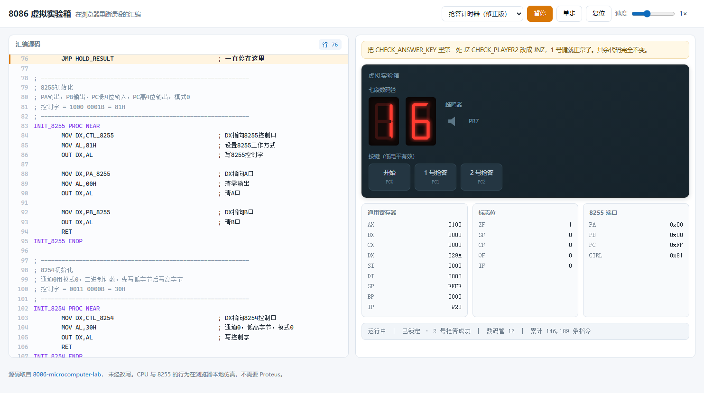

# 8086 虚拟实验箱

[](https://leslieryin.github.io/8086-emulator-lab/)


**在浏览器里跑微机原理课设的汇编，不用装 Proteus。**



## 为什么做这个

课设交上去是一堆 `.asm`、`.pdsprj` 和实验报告。别人想看你的抢答器真的跑起来，得：装 Proteus（好几个 G）→ 找 8086 元件库 → 搭电路 → 汇编出 exe → 手动载入程序存储器。绝大多数人走到第一步就放弃了。

这个页面把 8086 CPU 和 8255 搬到浏览器里：打开就能按「开始」，看数码管从 20 倒数；按抢答键，定格、锁定、蜂鸣器响一声。**源码一字未改**，跑的就是课设提交的那份汇编。

## 两个程序

| 程序 | 说明 |
|---|---|
| **抢答计时器** | 8255 + 8254，20 秒倒计时，双人抢答，数码管动态扫描 + 蜂鸣器。课设提交的原始版本 |
| **抢答计时器（修正版）** | 只改了一行 `JZ` → `JNZ` |

## 原版里的一个 bug

这件事值得单独说，因为它正好说明了模拟器的用处。

`CHECK_ANSWER_KEY` 里判断 1 号抢答键的几行：

```asm
        IN AL,DX
        TEST AL,02H                                  ; 检测PC1
        JZ CHECK_PLAYER2                             ; 若PC1未按，则去检查2号
```

**注释是对的，代码写反了。**

按键约定低电平有效，PC1 = 0 表示按下。`TEST AL,02H` 在 PC1=0 时结果为 0，ZF=1。要表达「未按下才跳过」，未按下时 PC1=1 使 ZF=0，应该用 `JNZ`。写成 `JZ`，逻辑就翻成了「**按下才跳过**」。

跑起来的现象：

- **1 号键按下去毫无反应**。PC1 被拉低 → `JZ` 跳去检查 2 号 → 此时 PC2 是高电平，`TEST AL,04H` 非零 → `JNZ CAK_EXIT` 直接退出。
- **2 号键能赢**，但走的是 `CHECK_PLAYER2` 分支——因为 PC2=1 也让 `TEST AL,04H` 非零，`JNZ CAK_EXIT` 不跳，于是顺序执行到 `MOV WINNER,2`。

换句话说：这套代码只有一个键能用，而且它判的永远是 2 号。

修正版把那一行改成 `JNZ`，1 号键立刻正常，2 号键不受影响。其余代码一字未动，界面上可以随时切换对照。

> 在 Proteus 里你也能看到「按 1 号没反应」这个现象，但很难一眼定位到是 `JZ`/`JNZ` 写反了——那是一个字符的差别。这里能单步、能看 ZF、能高亮当前行跟着走。

## 用法

| 操作 | 说明 |
|---|---|
| 点/按住按键 | 对应 PC0 / PC1 / PC2 拉低（低电平有效） |
| 空格 | 运行 / 暂停 |
| S | 单步执行 |
| R | 复位 |
| 速度滑块 | 0.25× ~ 16× |

左侧源码会跟着高亮当前正在执行的那一行；右侧实时显示数码管、蜂鸣器、通用寄存器、标志位和 8255 三个端口的值。

## 实现

### 汇编解析器（`js/asm.js`）

不做机器码编码，直接把源码解析成「指令对象列表」交给执行器。这个取舍换来两件事：能高亮正在执行的源码行，不用实现 ModR/M 编码的全部细节。

支持的语法子集：

- 段定义 `NAME SEGMENT` / `ENDS`、`ASSUME`（忽略）、`END 入口`
- `NAME EQU 值`
- `[NAME] DB/DW 值, 值...`、`n DUP(值)`
- 标号：`NAME:`、`NAME PROC [NEAR|FAR]`、以及**行内标号** `KD1: LOOP KD1`
- 变址寻址 `SEG_TAB[BX]`
- 30 条指令

解析分两遍：第一遍收集符号并给数据段分配地址，第二遍解析操作数——因为 `CALL SCAN_DISPLAY` 这类前向引用必须先知道标签位置。

### CPU（`js/cpu.js`）

30 条指令，带真实标志位语义（ZF/SF/CF/OF/PF/AF）、16 位栈、`CALL`/`RET`/`LOOP`。

和真实 8086 的差异（有意为之）：

- **IP 用指令索引而不是字节地址**——没有机器码，地址无意义
- **一条指令按 1 个时间单位计**——不做周期级时序
- 段寄存器只用于语法兼容，寻址统一在同一个 64K 空间

这些简化不影响外设交互的正确性：端口读写、标志位、跳转逻辑都是真的。

`AAM` 这条指令值得提一下——它的本意是乘法后做 BCD 调整，但在这个程序里被用来拆十位个位（`AH = AL/10, AL = AL%10`），比 `DIV` 省一个操作数。模拟器按真实语义实现，所以这个技巧能正常工作。

### 外设（`js/devices.js`）

`Board` 是一条端口总线：CPU 执行 `OUT/IN` 时按端口地址找到设备转发。8255 有 PA/PB/PC 三个端口加控制字，按键挂在 PC 低三位，蜂鸣器挂 PB7。

**动态扫描这里有个坑。** 程序每轮扫描都要「先灭段码 → 再切位选 → 最后送段码」，灭段那一瞬间位选仍然有效。如果照单全收，会把 `0x00` 锁存进去，界面上两位就闪没了。真实硬件上这段熄灭时间被视觉暂留抹平，模拟器里用「保留上次非零值」等效实现——所以两位能同时稳定显示。

### 速度（`js/ui.js`）

按指令数限速，`BASE_IPS = 30000`。这个数字是实测出来的：课设的软件延时循环（`WAIT_10MS` × 100 决定 1 秒）在解释器里对应约 3 万条指令，调到这里 20 秒倒计时才和真实时间对得上。

运行时会做欠账补偿：`budget += dt × IPS`，每执行一条扣 1。切到后台再回来不会一次补算太多（单帧上限 40 万条）。

## 运行

ES modules 不能从 `file://` 直接打开，需要起个静态服务：

```bash
python -m http.server 8000
# 打开 http://localhost:8000
```

或者直接用[在线版](https://leslieryin.github.io/8086-emulator-lab/)。

## 测试

```bash
node tests/emulator.test.mjs
```

36 项断言，跑的是 `js/programs.js` 里内嵌的真实课设汇编，断言的是外设层面可观测的行为（数码管显示什么、谁被判赢、锁定标志、蜂鸣器有没有响），而不是内部实现。覆盖：解析、上电初始化、开始键、倒计时递减、两个版本各自的抢答行为、锁定后按键无效、超时自动锁定、段码解码。

## 已知限制

- **只支持这两个程序用到的 30 条指令**，不是完整 8086
- **没有 8259 中断控制器和 ADC0808**，所以课设里的另一个实验「ADC 定时采样」还没搬上来——它依赖中断向量表和 `ES:[BX]` 寻址，需要另外补
- 8254 只接受写入，没有模拟计数
- 时序不是周期级的，只有「一条指令一个单位」

## 许可证

[MIT](LICENSE)
